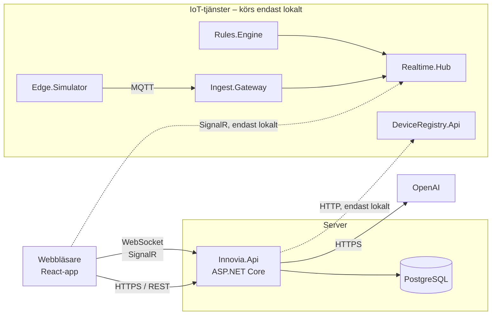

# Innovia Hub

Innovia Hub är ett bokningssystem för coworkingcentret Innovia Hub. Medlemmar bokar skrivbord, mötesrum, VR-headset och AI-servern direkt i webbläsaren och ser i realtid vad som är ledigt. Husassistenten **Nova** (AI) svarar på frågor om huset dygnet runt. Administratörer hanterar resurser, öppettider, användare och bokningar, följer beläggningen och ser live-mätvärden från sensorer i lokalerna.

## Innehåll

- [Testa den driftsatta versionen](#testa-den-driftsatta-versionen)
- [För kunden: vad systemet gör](#för-kunden-vad-systemet-gör)
- [Funktioner jag har vidareutvecklat](#funktioner-jag-har-vidareutvecklat)
- [Teknikstack](#teknikstack)
- [Arkitektur](#arkitektur)
- [Kör projektet lokalt](#kör-projektet-lokalt)
- [Konfiguration och miljövariabler](#konfiguration-och-miljövariabler)
- [Tester och CI](#tester-och-ci)
- [Driftsättning](#driftsättning)
- [Säkerhet](#säkerhet)
- [Kända begränsningar](#kända-begränsningar)
- [Mer dokumentation](#mer-dokumentation)

---

## Testa den driftsatta versionen

**Länk:** https://innovia.157-230-105-26.sslip.io

| Roll   | E-post          | Lösenord     |
| ------ | --------------- | ------------ |
| Admin  | admin@admin.com | Password123! |
| Medlem | test@test.com   | Password123! |

Du kan också registrera ett eget medlemskonto via **Registrera**.

### Förslag på testflöde

1. **Bokning (medlem):** Logga in som medlem → **Resurser** → välj t.ex. ett mötesrum, en dag och lediga tider → boka. Bokningen syns under **Mina bokningar**, där den också kan avbokas.
2. **Realtid:** Öppna appen i två fönster, ett som medlem och ett som admin (t.ex. ett vanligt och ett inkognitofönster).
   - Boka som medlem → bokningen dyker upp direkt under **Alla bokningar** hos admin, och beläggningsdiagrammet uppdateras.
   - Sätt en resurs i **Underhåll** som admin (**Resurser**) → statusen ändras direkt i medlemmens resurslista.
3. **AI-assistenten Nova:** Klicka på den runda knappen nere till höger (syns för inloggade). Prova förslagsknapparna eller frågor som _"Vilka mötesrum finns?"_, _"När har ni öppet på lördag?"_, _"Finns det kaffe?"_. Svaret strömmas fram i realtid. Möjligheten till följdfrågor finns då Nova har en medskickad historik på 6 meddelanden.
4. **Admin:** **Resurstyper** (öppettider och bokningsregler), **Användare**, **Beläggning** (välj datumintervall).
5. **Sensorer (IoT):** IoT-tjänsterna är inte driftsatta (enligt uppgiften). Sidan **Sensorer** visar därför ett tydligt meddelande om att sensortjänsten är offline, i stället för att appen kraschar. Hur IoT-delen körs lokalt beskrivs i [docs/README_Iot.md](docs/README_Iot.md).

---

## För kunden: vad systemet gör

**För medlemmar**

- Se alla resurser, deras status (tillgänglig, underhåll, ur drift) och lediga tider.
- Boka och avboka. Systemet hindrar dubbelbokningar, för långa bokningar och bokningar för långt fram i tiden.
- Fråga Nova om huset: öppettider, regler, kök, vilka resurser som finns och vad som är bokningsbart just nu.

**För administratörer**

- Skapa, redigera, arkivera och ändra status på resurser och resurstyper, inklusive öppettider per veckodag.
- Se och hantera alla bokningar och användare.
- Följ beläggningen i procent, både just nu och för valfritt datumintervall.
- Se temperatur och CO₂ live per rum, med larm när ett gränsvärde överskrids.

Allt uppdateras i realtid. Ingen behöver ladda om sidan för att se nya bokningar eller statusändringar.

---

## Funktioner jag har vidareutvecklat

Projektet började som ett grupparbete (bokningsflöde, inloggning, resurshantering och grundstruktur), medan AI-tjänsten Nova och IoT sensortjänster integrerades i den individuella delen av projektet.

| Område                       | Vad                                                                                                                                                                                                                                                                                                                                                                               |
| ---------------------------- | --------------------------------------------------------------------------------------------------------------------------------------------------------------------------------------------------------------------------------------------------------------------------------------------------------------------------------------------------------------------------------- |
| **AI – husassistenten Nova** | Chattwidget med strömmade svar via SignalR (`/hubs/chat`). Svarar utifrån `knowledge.md` och live-data ur databasen (tid, öppettider, resursstatus). Följdfrågor, rate limit (20 frågor/timme), skydd mot prompt-manipulation, stoppknapp, anslutningsstatus och 38 enhetstester. Se [docs/README_Nova.md](docs/README_Nova.md).                                                  |
| **IoT-integration**          | Integration med IoT-tjänsterna (DeviceRegistry, Ingest.Gateway, Realtime.Hub, Rules.Engine, Edge.Simulator): 20 simulerade sensorer, `GET /sensors` i API:t, sensorsida med live-värden, larmregler i Rules.Engine och larm i realtid i UI:t. Flera buggar i IoT-tjänsterna rättade. Se [docs/README_Iot.md](docs/README_Iot.md) och [Implementation.md](docs/Implementation.md). |
| **Offline-hantering (IoT)**  | Sensorsidan visar tydligt när sensortjänsten är offline: felruta vid 503 (utan onödiga omförsök) och en statusbadge Live/Ansluter…/Offline. Ingen anslutning görs till Realtime.Hub när den inte är konfigurerad, vilket gäller i produktion.                                                                                                                                     |
| **Driftsättning och CI/CD**  | Driftsättning på DigitalOcean (Droplet, Docker Compose, Caddy med automatisk HTTPS) med CI/CD via GitHub Actions. Novas kunskapsfiler inkluderade i Docker-imagen och OpenAI-nyckeln som miljövariabel i produktion. Felsökning av CI: ett TypeScript-fel som stoppade frontend-bygget, integrationstester som krävde en OpenAI-nyckel och ett inaktuellt test.                   |

---

## Teknikstack

| Del           | Tekniker                                                                                                                                      |
| ------------- | --------------------------------------------------------------------------------------------------------------------------------------------- |
| Backend       | .NET 10, ASP.NET Core Minimal API, Entity Framework Core + Npgsql, ASP.NET Core Identity, JWT i `HttpOnly`-cookies, SignalR, Scalar (OpenAPI) |
| AI            | OpenAI (`gpt-4.1`) via `Microsoft.Extensions.AI` (`IChatClient`)                                                                              |
| Frontend      | React 19, TypeScript, Vite, React Router, TanStack Query, Tailwind CSS, `@microsoft/signalr`, Recharts                                        |
| Databas       | PostgreSQL 17                                                                                                                                 |
| IoT (lokalt)  | .NET 8-mikrotjänster, MQTT (Mosquitto), TimescaleDB                                                                                           |
| Test          | xUnit, `Microsoft.AspNetCore.Mvc.Testing`, Testcontainers (riktig Postgres i Docker), Moq                                                     |
| Infrastruktur | Docker, Docker Compose, Caddy (reverse proxy + HTTPS), GitHub Actions, DigitalOcean                                                           |

---

## Arkitektur



### Backend: vertical slices

Varje funktion ligger i en egen mapp under `Innovia.Api/Features/`, t.ex. `Features/Bookings/CreateBooking/`, med filerna `Endpoint`, `Command`/`Request`, `Handler`, `Validator` och `Response`. Ingen MediatR, utan endpointen anropar handlern direkt. Varje feature har en `*ServiceExtensions.cs` som registrerar beroenden och mappar endpoints, och de anropas från `Program.cs`.

Gemensam kod ligger i `Innovia.Api/Common/` (auth, databas, `Result`-mönstret, felhantering, tidszon).

- **Result-mönster:** handlers returnerar `Result`/`Result<T>` i stället för att kasta exceptions för förväntade fel (t.ex. "resursen är redan bokad"). Resultatet mappas till rätt HTTP-status och `ProblemDetails`.
- **Databas:** EF Core-migrationer körs automatiskt vid uppstart, och grunddata (roller, admin, resurstyper, öppettider, resurser) seedas. Dubbelbokning stoppas även med en constraint i databasen.

### Realtid (SignalR)

| Hub                | Används till                                                                                  |
| ------------------ | --------------------------------------------------------------------------------------------- |
| `/hubs/bookings`   | Bokning skapad/uppdaterad/avbokad, per resursgrupp och till en admin-grupp med alla bokningar |
| `/hubs/resources`  | Ändrad resursstatus, till alla inloggade                                                      |
| `/hubs/chat`       | Novas svar, strömmade som `IAsyncEnumerable<string>`                                          |
| Realtime.Hub (IoT) | Mätvärden (`measurementReceived`) och larm (`alertRaised`), endast lokalt                     |

Frontend har en delad anslutning per hub (`frontend/src/lib/*HubConnection.ts`) med automatisk återanslutning. Hooks lyssnar på händelserna och ber TanStack Query hämta om berörd data (`invalidateQueries`), så listor och diagram alltid visar aktuellt läge utan polling.

### Frontend

- `src/api/`: tunna, typade anrop per backend-område. `client.ts` skickar alltid med cookies (`credentials: "include"`) och förnyar en utgången access token automatiskt.
- `src/hooks/`: TanStack Query-hooks och realtidshooks.
- `src/pages/member` och `src/pages/admin`: sidorna, skyddade av `ProtectedRoute` beroende på roll.

### Projektstruktur

```
innovia-hub4/
├── Innovia.Api/              # Backend (.NET 10)
│   ├── Common/               # Auth, Database, Result, Errors, Time …
│   ├── Features/             # Vertical slices (Bookings, Resources, Assistant, Sensors …)
│   └── Program.cs
├── frontend/                 # React + Vite + TypeScript
├── tests/Innovia.Api.Tests/  # xUnit + Testcontainers
├── iot/                      # IoT-tjänsterna + seed-skript (körs lokalt)
├── docs/                     # Fördjupning: Nova och IoT
├── docker-compose.yaml       # Lokal databas
├── docker-compose.dev.yaml   # Hela appen i Docker lokalt
├── docker-compose.prod.yaml  # Produktion
└── .github/workflows/        # CI och deploy
```

---

## Kör projektet lokalt

### Förutsättningar

- .NET 10 SDK
- Node.js 22
- Docker Desktop
- En OpenAI API-nyckel (API:t startar inte utan den)

### Alternativ A: native (rekommenderas)

```bash
# 1. Databas (PostgreSQL på port 5433)
docker compose up -d

# 2. OpenAI-nyckel, en gång per dator (sparas utanför repot)
cd Innovia.Api
dotnet user-secrets set "OpenAI:ApiKey" "sk-..."

# 3. Backend – migrationer och seed körs automatiskt
dotnet run --launch-profile https       # https://localhost:7229

# 4. Frontend (ny terminal, från repo-roten)
cd frontend
npm install
npm run dev                             # http://localhost:5173
```

### Alternativ B: allt i Docker

Skapa en `.env` i repo-roten (ignoreras av git):

```env
OPENAI_API_KEY=sk-...
```

```bash
docker compose -f docker-compose.dev.yaml up
```

API på `http://localhost:5123`, frontend på `http://localhost:5173`, båda med hot reload.

### Logga in

Admin: `admin@admin.com` / `Password123!` (endast lokalt, sätts i `appsettings.json`). Medlemskonton skapas via **Registrera**.

API-dokumentation (Scalar) finns i Development-läge på `https://localhost:7229/scalar/v1`.

IoT-tjänsterna är valfria lokalt. Utan dem visar sensorsidan att tjänsten är offline. Se [docs/README_Iot.md](docs/README_Iot.md) för att starta dem.

---

## Konfiguration och miljövariabler

Lokalt läser backend från `Innovia.Api/appsettings.json` och user-secrets. I produktion sätts allt som miljövariabler (se [`example.env`](example.env)). Dubbelt understreck motsvarar kolon, t.ex. `OpenAI__ApiKey` = `OpenAI:ApiKey`.

| Variabel                                              | Beskrivning                                                                       |
| ----------------------------------------------------- | --------------------------------------------------------------------------------- |
| `OPENAI_API_KEY`                                      | **Hemlig.** OpenAI-nyckel till Nova                                               |
| `POSTGRES_USER` / `POSTGRES_PASSWORD` / `POSTGRES_DB` | Databasuppgifter                                                                  |
| `JWT_ISSUER` / `JWT_AUDIENCE` / `JWT_SECRET`          | JWT-inställningar. Secret ska vara lång och slumpad                               |
| `ADMIN_EMAIL` / `ADMIN_PASSWORD`                      | Admin-kontot som seedas vid första start                                          |
| `FRONTEND_ORIGIN`                                     | Frontendens adress, tillåts av CORS (krävs även för SignalR)                      |
| `VITE_API_URL`                                        | API:ts adress. Bakas in i frontend vid bygget                                     |
| `APP_DOMAIN` / `API_DOMAIN`                           | Adresserna Caddy hämtar HTTPS-certifikat för och skickar vidare till frontend/api |
| `GHCR_OWNER`                                          | GitHub-kontot vars images hämtas från GitHub Container Registry                   |

---

## Tester och CI

```bash
dotnet test tests/Innovia.Api.Tests/Innovia.Api.Tests.csproj    # kräver att Docker körs
cd frontend && npm run lint
```

Testerna körs mot en riktig PostgreSQL i Docker (Testcontainers), inte en in-memory-databas, så databasregler och EF Core-frågor testas på riktigt. Novas tester använder en `FakeChatClient` och anropar aldrig OpenAI.

GitHub Actions (`.github/workflows/ci.yaml`) bygger och testar backend samt lintar och bygger frontend vid varje push och pull request mot `main` och `dev`.

---

## Driftsättning

Applikationen körs på en **DigitalOcean Droplet** (Ubuntu, 2 GB RAM) med Docker Compose.

**Containrar** (`docker-compose.prod.yaml`):

| Container  | Roll                                                                                           |
| ---------- | ---------------------------------------------------------------------------------------------- |
| `caddy`    | Reverse proxy och automatisk HTTPS (Let's Encrypt). Enda containern med öppna portar (80/443). |
| `frontend` | Byggd React-app, serverad som statiska filer                                                   |
| `api`      | Innovia.Api (ASP.NET Core)                                                                     |
| `postgres` | Databas, på ett internt nätverk som inte nås utifrån                                           |

**Domän:** https://innovia.157-230-105-26.sslip.io/
Servern har ingen egen domän, så den använder [sslip.io](https://sslip.io), som översätter `innovia.157-230-105-26.sslip.io` och `api.157-230-105-26.sslip.io` direkt till serverns IP-adress. Frontend och API får egna adresser men räknas som samma sajt, så inloggningscookien fungerar i alla webbläsare.

**CI/CD** (GitHub Actions):

1. `ci.yaml` bygger och testar backend och frontend vid varje pull request.
2. `deploy.yaml` körs vid push till `main`: bygger Docker-images för API och frontend, publicerar dem i GitHub Container Registry, kopierar `docker-compose.prod.yaml` och `Caddyfile` till servern via SSH och startar om containrarna med den nya versionen.

**Hemligheter och miljökonfiguration:**

- På servern ligger en `.env` (endast läsbar för användaren `deploy`) med databaslösenord, JWT-secret, admin-konto och OpenAI-nyckel. Den finns aldrig i git.
- I GitHub ligger SSH-uppgifterna som secrets (`DEPLOY_HOST`, `DEPLOY_USER`, `DEPLOY_PATH`, `DEPLOY_SSH_KEY`) och API-adressen som variabeln `VITE_API_URL`, som bakas in i frontend vid bygget.
- GitHub Actions loggar in som en egen användare (`deploy`) med SSH-nyckel, inte som root.

---

## Säkerhet

- Access token (15 min) och refresh token (1 dag, roteras och lagras hashad) ligger i `HttpOnly`-cookies och kan inte läsas av JavaScript. Återanvänds en redan använd refresh token återkallas hela token-familjen.
- Cookies är `Secure` och `SameSite=None`, eftersom frontend och API ligger på olika adresser. CORS släpper bara igenom frontendens egen adress.
- Alla endpoints och hubbar kräver inloggning om de inte uttryckligen är öppna. Admin-funktioner skyddas med policyn `AdminOnly`.
- Inloggning låser kontot efter upprepade felförsök.
- OpenAI-nyckeln ligger i user-secrets lokalt och som miljövariabel i produktion, aldrig i git eller frontend. Nova får inga personuppgifter och kan bara läsa, inte ändra något.

---

## Kända begränsningar

- IoT-tjänsterna är inte driftsatta, så sensorsidan visar inga live-värden i den publicerade versionen.
- Realtime.Hub (IoT) saknar inloggning. Vem som helst som når den kan lyssna och skicka värden. Därför körs den bara lokalt.
- Nova minns bara de 6 senaste meddelandena och glömmer konversationen när sidan laddas om.
- Servern har ingen egen domän, utan använder sslip.io. Det räcker för test men inte för en riktig kund.
- DataProtection-nycklarna sparas inne i API-containern och försvinner vid omstart. Inloggningen påverkas inte (den bygger på JWT), men funktioner som e-postbekräftelse skulle göra det.
- Ingen automatisk backup av databasen.

---

## Mer dokumentation

| Fil                                                       | Innehåll                                                       |
| --------------------------------------------------------- | -------------------------------------------------------------- |
| [docs/README_Nova.md](docs/README_Nova.md)                | AI-assistenten Nova: konfiguration, filer, kontext, felsökning |
| [docs/README_Iot.md](docs/README_Iot.md)                  | IoT-tjänsterna: portar och startordning                        |
| [Implementation.md](docs/Implementation.md)               | IoT-integrationen: ändringar och rättade buggar                |
| [Testning_och_kvalitet.md](docs/Testning_och_kvalitet.md) | Novas tester, framtidssäkring och säkerhet                     |
