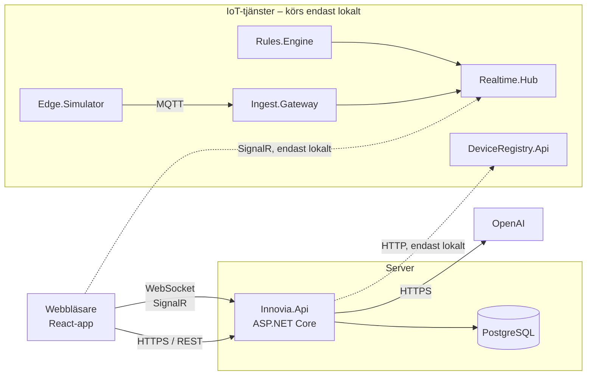

## Reflektion

### Vad du har lärt dig under kursen och projektet.

- Nytt arkitekturmönster: projektet har gett en ingång i arkitekturmönstret Vertical Slice som jag tidigare inte använt. Det har varit intressant att testa och även gett mig bra förståelse i att olika projekt kan se väldigt olika ut, beroende på hur tex teamet väljer att tackla det. Jag upplevde att vertical slice var toppen utifrån att projektet först startade som grupp, men även när jag vidareutvecklade det individuellt så upplever jag att vertical slice skapar en avgränsad tydlighet som är väldig tacksam när man skapar nya feature (speciellt som ny, man behöver bara vara "inkopplad" på den kod man jobbar med i stunden).
- SignalR och realtidskommunikation: En annan stor lärdom har varit hur man arbetar med SignalR, hur realtidskommunikation funkar och kopplingarna på hub-nivå mellan frontend och backend. Det har varit kul att i UI se hur livedata skapar en helt annan sorts användarupplevelse, jämfört med sidor som kräver tex en refresh för uppdaterade värden.
- AI-integration: Otroligt kul att få integrera en AI i projektet, och se hur "lätt" det är att med nyckel till yttre tjänst kunna skräddarsy den AI man själv vill ha i projektet. Tex att ens husassistent är begränsad till den information man ger den, och att man i övningar (utanför projektet men inom kursens ram) även kunnat testa att ge olika personligheter.
- Läsa och få ihop olika projekt: En utmaning i IoT var absolut att lära sig att samverka mellan olika typer av tjänster och ha igång flera databaser och anrop samtidigt för ett ihållande flöde från tex simulerade sensorer av Edge.Simulator till visning på egen frontend-sida och alla steg däremellan.
- Docker/driftsättning i droplet: Jag har lärt mig mer kring hur man driftsätter ett projekt, och att göra detta via en droplet. Det har varit lärorikt att använda user secrets lokalt, en .env-fil på servern och secrets i GitHub, och att förstå mer kring vilken konfiguration som hör hemma var. Från gruppens projekt fanns även workflows konfigurerade, och jag har lärt mig mer kring hur de hänger ihop: en pull request startar automatiskt bygget och tester (CI), och när den mergas till main driftsätts den nya versionen automatiskt (CD).

### Vilka val du har gjort och varför.

- Valde droplet framför app platform i driftsättning: Redan vid första driftsättningen som grupp gjordes en droplet, och det kändes därmed roligt att fortsätta utmana mig i den individuella fasen genom att skapa en droplet även denna gång (framför att tex använda det "enklare" app platform). Det passade också bättre utifrån hur projektet är byggt. Inloggningen bygger på en cookie som skickas mellan frontend och API. På app platform hade de fått två helt separata webbadresser, vilket gör att vissa webbläsare (tex Safari) blockerar cookien och användaren inte kan logga in. På dropleten kunde jag ge frontend och API adresser som hör ihop (innovia.… och api.… på samma grunddomän), så inloggningen fungerar i alla webbläsare utan att jag behövde ändra i koden. Projektet hade dessutom redan färdiga filer för just den här lösningen (docker-compose, Caddy och GitHub Actions).
- User secrets framför .env i utvecklingsmiljö: Jag använde user secrets för OpenAI-nyckeln i stället för en .env-fil, eftersom det kändes som ett säkrare val. En .env-fil kan av misstag pushas upp till GitHub om man glömt lägga den i .gitignore medan user secrets ligger utanför projektmappen. I produktion ligger nyckeln istället i en .env-fil direkt på servern, som aldrig finns i repot och bara kan läsas av den användare som kör appen.

### Hur du har hanterat eventuella problem eller utmaningar.

En hel del problem har såklart uppstått under projektets gång, och AI har varit en stor hjälp för att diskutera, felsöka och lösa dem. Eftersom jag i den senare delen av projektet arbetat själv på distans har det varit värdefullt att kunna bolla buggar med en "artificiell kollega". En del utmaningar har också handlat om design, alltså hur de olika delarna ska utformas och vad som ryms inom projektets scope.
I [Implementation.md](Implementation.md) finns mer information om ändringar och buggar som lösts under IoT-integrationen. I slutskedet uppstod även några problem kopplade till driftsättningen:

- Nova hade slutat fungera i Docker: .dockerignore uteslöt alla .md-filer, och därmed även de md-filer som Nova läser vid varje fråga. Detta upptäcktes innan driftsättningen och löstes genom att undanta just de två filerna, så att de följer med i bygget.
- CI hade aldrig körts i min fork: GitHub stänger av workflows i forks som standard. När jag slog på dem syntes tre fel som legat dolda: ett TypeScript-fel som stoppade frontend-bygget, integrationstester som krävde en OpenAI-nyckel (de fungerade lokalt pga user secrets, men inte i en ren miljö) och ett test som inte uppdaterats när texten för stängda dagar ändrats. Efter att felen rättats gick projektets samtliga 84 tester igenom.
- Sensorsidan när IoT-tjänsten är offline: Vid test lokalt utan IoT-tjänsterna hängde sidan på "Laddar sensorer..." i över 10 sekunder, eftersom frontend försökte igen flera gånger. I produktion hade den dessutom försökt ansluta till localhost på besökarens dator. Lösningen blev att inte försöka igen när API:t svarar 503 (tjänsten är nere), och att inte ansluta till Realtime.Hub alls när den inte är konfigurerad. Sidan visar nu direkt att sensorerna är offline.

### Vad du skulle vilja förbättra om du hade mer tid.

Jag hade gärna utvecklat Nova till att bli en bokningsassistent såväl som husassistent som svarar på frågor. Jag hade även velat göra en admin-version av henne som hjälper admin med arbetsuppgifter kopplat till tex "ta bort den här användarens bokning" eller "hur kollar jag om den här är ledig" etc.
Jag hade även velat utveckla systemet som helhet, kanske att Innovia Hub inte bara är ett bokningssystem utan även skulle kunna bli ett nav för medlemmarna, tex kanske ha en forumdel för inloggade användare med möjligheten att få till ökad interaktion. Eftersom Innovia är ett coworking-center så kan man tänka sig att flera medlemmar har sina egna företag/uppdrag men söker sig till en fysisk plats. Ett forum med möjlighet för medlemmar att tex luncha ihop, ta en AW eller hjälpa varandra med olika svårigheter skulle kunna gör att känslan går ifrån "kontorshotell där man sitter på en plats" till interaktivt coworking-center som skapar en kollegial känsla mellan medlemmar.

### En kort arkitekturskiss över applikationens struktur.

```
innovia-hub4/
├── Innovia.Api/              # Backend (.NET 10)
│   ├── Common/               # Auth, Database, Result, Errors, Time …
│   ├── Features/             # Vertical slices (Bookings, Resources, Assistant, Sensors …)
│   └── Program.cs
├── frontend/                 # React + Vite + TypeScript
├── tests/Innovia.Api.Tests/  # xUnit + Testcontainers
├── iot/                      # IoT-tjänsterna + seed-skript (körs lokalt)
├── docs/                     # Fördjupning: Nova och IoT
├── docker-compose.yaml       # Lokal databas
├── docker-compose.dev.yaml   # Hela appen i Docker lokalt
├── docker-compose.prod.yaml  # Produktion
└── .github/workflows/        # CI och deploy
```

---



### Beskrivning av hur realtidsfunktioner implementerats.

Realtidsfunktioner har implementeras kontinuerligt i applikation, och finns i fyra delar av applikationen: bokningar, resursstatus, chatten med Nova och IoT-mätvärden. Varje del har en egen hub med ett eget ansvarsområde.

- BookingHub: Bokning skapad, ändrad eller avbokad.
- ResourceHub: Ändrad status på en resurs (tex underhåll).
- ChatHub: Novas svar, som strömmas fram ord för ord.
- Realtime.Hub (IoT): Mätvärden och larm från sensorerna.

Frontend har en delad anslutning per hub som återansluter automatiskt om nätverket bryts.

### Kort beskrivning av hur driftsättning och miljökonfiguration gjorts.

Jag driftsatte applikationen på en Droplet hos DigitalOcean, där den körs som fyra Docker-containrar: Caddy (tar emot trafiken och sköter HTTPS automatiskt), frontend, API och PostgreSQL. Databasen ligger på ett internt nätverk och kan inte nås utifrån.
Driftsättningen sker automatiskt via GitHub Actions. När något mergas till main byggs nya Docker-images för API och frontend, och servern hämtar dem och startar om containrarna. Flera av filerna för detta (docker-compose, Caddyfile och workflows) fanns redan från gruppfasen, men jag satte upp en ny server och anpassade konfigurationen.
Miljökonfigurationen är uppdelad efter vad som är hemligt:

- På servern ligger en .env-fil med databaslösenord, JWT-secret, admin-konto och OpenAI-nyckel.
- I GitHub ligger SSH-uppgifterna till servern som secrets, och API-adressen som en vanlig variabel eftersom den inte är hemlig.
- Lokalt används appsettings.json och user secrets.

### Eventuella kända problem eller begränsningar.

- IoT-tjänsterna är inte driftsatta, så sensorsidan visar inga live-värden i den publicerade versionen.
- Realtime.Hub (IoT) saknar inloggning. Vem som helst som når den kan lyssna och skicka värden. Därför körs den bara lokalt.
- Nova minns bara de 6 senaste meddelandena och glömmer konversationen när sidan laddas om.
- Servern har ingen egen domän, utan använder sslip.io. Det räcker för test men inte för en riktig kund.
- DataProtection-nycklarna sparas inne i API-containern och försvinner vid omstart. Inloggningen påverkas inte (den bygger på JWT), men funktioner som e-postbekräftelse skulle göra det.
- Ingen automatisk backup av databasen.
